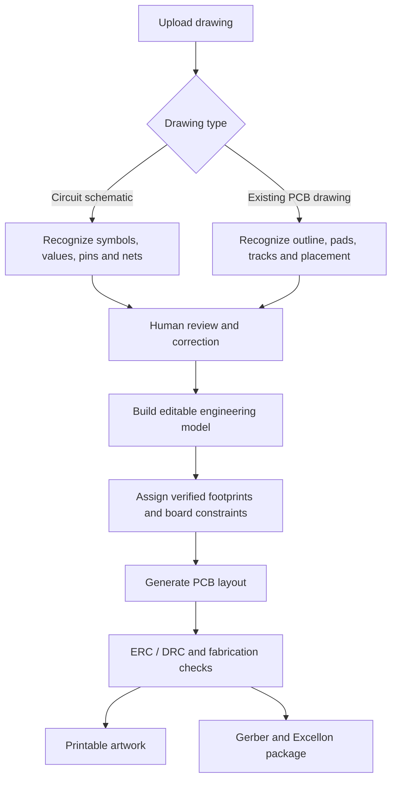
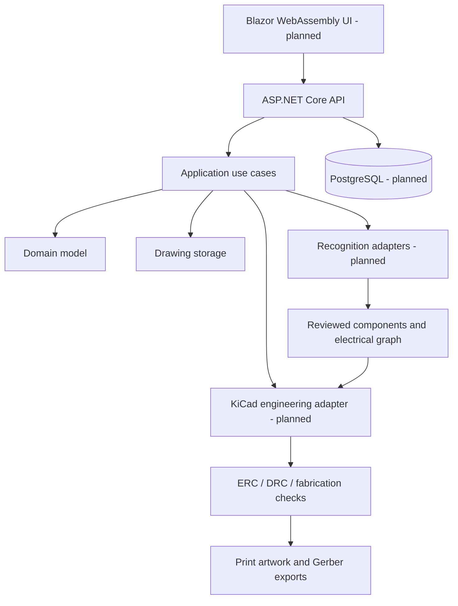

# AI PCB Designer

<p align="center">
  <strong>From circuit drawing to editable PCB, printable artwork, and fabrication files.</strong>
</p>

<p align="center">
  
  
  
  
</p>

AI PCB Designer is an AI-assisted electronics design platform intended to turn **hand-drawn circuit schematics** and **existing PCB drawings** into editable engineering designs. Its planned outputs are:

- **Printable PCB artwork** — exact-scale PDF, SVG, and PNG, including a selectable mirrored copper layer for toner-transfer workflows.
- **Manufacturing package** — Gerber files, Excellon drill data, BOM, and a validation report.

> **Current status:** This repository is at the initial backend foundation stage. Drawing upload and local storage are scaffolded. Drawing classification is currently a placeholder. AI recognition, schematic reconstruction, PCB layout/routing, KiCad integration, DRC, Gerber generation, and printable exports are not implemented yet. Do not use the current application to manufacture a PCB.

## Product workflow

The target user experience is:



The two input modes are deliberately separate. A schematic describes **electrical connectivity**; a PCB drawing describes **physical geometry and routing**. A photograph of a PCB must not be treated as if it were a circuit schematic.

## Key capabilities planned

| Area | Planned capability |
|---|---|
| Drawing intake | JPG, JPEG, PNG, PDF, and SVG upload |
| Image preparation | Rotation, crop, perspective correction, denoising, contrast enhancement |
| Drawing classification | Distinguish circuit schematics from existing PCB drawings |
| AI recognition | Identify symbols, component labels, values, pins, pads, tracks, and board outlines |
| Schematic reconstruction | Editable symbols, pin numbers, nets, power symbols, and junctions |
| Human review | Confidence scores, source evidence, and correction of uncertain results |
| PCB design | Board dimensions, copper layers, footprints, placement, tracks, vias, and mounting holes |
| Validation | Electrical Rule Check (ERC), Design Rule Check (DRC), and fabrication checks |
| Preview | Interactive 2D editor and 3D board preview |
| Printable output | Exact 1:1 PDF/SVG/PNG, copper-side selection, optional mirror, drill and placement templates |
| Manufacturing output | Gerber layers, Excellon drill files, BOM, and manufacturing report |

## Engineering principles

1. **AI proposes; engineering tools validate.** A language or vision model must never be the source of truth for copper geometry or electrical correctness.
2. **No silent guessing.** Ambiguous wire crossings, junctions, polarity, pin numbering, component values, and footprints must be flagged for user review.
3. **KiCad is the engineering source of truth.** The intended integration uses KiCad-native schematic and PCB artifacts plus its command-line tooling for validation and fabrication exports.
4. **Versioned designs.** Exports should be tied to a specific reviewed board revision and record tool versions, layer settings, units, and print mirroring.
5. **Manufacturing status is earned.** A design must not be labelled fabrication-ready while required ERC, DRC, footprint, or manufacturing checks remain unresolved.

## Technology direction

| Layer | Technology |
|---|---|
| Backend | ASP.NET Core Web API, .NET 10 |
| Architecture | Modular Clean Architecture |
| Frontend | Blazor WebAssembly (planned) |
| Persistence | PostgreSQL + Entity Framework Core (planned) |
| AI integration | Provider-independent abstraction for vision/OCR models (planned) |
| Image processing | OpenCV (planned) |
| PCB engineering | KiCad CLI and native project formats (planned) |
| Background processing | Hangfire or a dedicated worker (planned) |
| Real-time progress | SignalR (planned) |
| Testing | xUnit and integration tests |

### High-level architecture



## Repository structure

The initial code is organized into these projects:

```text
src/
  PCBDesigner.Api/             ASP.NET Core endpoints and dependency injection
  PCBDesigner.Application/     Use cases and ports/abstractions
  PCBDesigner.Domain/          Core domain concepts
  PCBDesigner.Infrastructure/  Storage and external-engine adapters
  PCBDesigner.Tests/           Automated tests
docs/
  PRODUCT_REQUIREMENTS.md      MVP scope and acceptance expectations
  ARCHITECTURE.md              Architecture decisions
```

## Current implementation

| Capability | Status |
|---|---|
| .NET 10 API foundation | Scaffolded |
| Health endpoint | Implemented: `GET /health` |
| Drawing upload endpoint | Implemented: `POST /api/drawings` |
| Extension allow-list and 20 MB limit | Implemented in upload endpoint |
| Local file storage | Implemented |
| Drawing classifier interface | Implemented |
| Real schematic/PCB classifier | Not implemented (placeholder returns `Unknown`) |
| Image preprocessing / OCR / AI recognition | Not implemented |
| Schematic and netlist generation | Not implemented |
| KiCad project generation | Not implemented |
| PCB placement and routing | Not implemented |
| ERC / DRC | Not implemented |
| Gerber / Excellon / printable exports | Not implemented |
| Frontend / interactive editor | Not implemented |
| Database persistence and project history | Not implemented |

## Getting started

### Prerequisites

- .NET 10 SDK
- Git
- KiCad is needed for later PCB generation and export milestones; it is not yet wired into the current upload foundation.

### Build and run the API

From the repository root:

```bash
dotnet restore src/PCBDesigner.Api/PCBDesigner.Api.csproj
dotnet build src/PCBDesigner.Api/PCBDesigner.Api.csproj
dotnet run --project src/PCBDesigner.Api/PCBDesigner.Api.csproj
```

In Development, the OpenAPI document is exposed at:

```text
/openapi/v1.json
```

Health check:

```bash
curl http://localhost:<port>/health
```

### Upload a drawing

The upload endpoint accepts multipart form data. The form field must be named `file`.

```bash
curl -X POST "http://localhost:<port>/api/drawings" \
  -F "file=@./sample-schematic.png"
```

Supported extensions in the current endpoint: `.png`, `.jpg`, `.jpeg`, `.pdf`, and `.svg`. Maximum upload size: 20 MB.

By default, uploaded files are stored under `App_Data/uploads` relative to the API content root. The root can be changed with the `Storage:RootPath` configuration setting.

**Note:** The current endpoint only accepts and stores the upload. The classifier returns `Unknown`; it does not yet extract components or electrical connections.

## Roadmap

### Phase 1 — Upload and project foundation
- [x] Establish .NET API and layered project structure
- [x] Add health endpoint
- [x] Add drawing upload endpoint with extension and size checks
- [x] Add local storage adapter
- [x] Add replaceable drawing-classification abstraction
- [ ] Add upload metadata persistence and project ownership
- [ ] Add secure content inspection, malware scanning, and storage quotas

### Phase 2 — Image preprocessing and classification
- [ ] Image orientation and perspective correction
- [ ] PDF page rasterization and image normalization
- [ ] Classify schematic vs. existing PCB drawing
- [ ] Return classification confidence and review state

### Phase 3 — Recognition and human review
- [ ] Component and label recognition
- [ ] Pin, wire, junction, pad, and trace extraction
- [ ] Confidence and source-region provenance
- [ ] Review UI for correcting uncertain recognition

### Phase 4 — Schematic and electrical model
- [ ] Build normalized component/pin/net graph
- [ ] Generate editable schematic
- [ ] Validate missing pins, ambiguous nets, and power connections
- [ ] Map verified components to library symbols and footprints

### Phase 5 — PCB design
- [ ] Generate KiCad project and board
- [ ] Board outline, dimensions, layers, and mounting holes
- [ ] Component placement and manual adjustment
- [ ] Routing and copper zones
- [ ] 2D and 3D preview

### Phase 6 — Validation and export
- [ ] KiCad ERC and DRC integration
- [ ] Fabrication constraints and export gating
- [ ] Gerber and Excellon generation
- [ ] Exact-scale printable artwork with explicit mirror controls
- [ ] BOM and manufacturing report
- [ ] Automated fixtures and regression tests for representative drawings

## Security and reliability

Before production use, the application must add:
- File signature/content validation in addition to extension checks.
- Safe PDF/SVG parsing and resource limits.
- Malware scanning and upload quotas.
- Authentication, authorization, and per-project access control.
- Isolated, resource-limited workers for image processing and KiCad execution.
- Secrets management; no AI provider keys committed to source control.
- Audit history for user corrections and generated revisions.
- Automated tests for malformed files, oversized uploads, interrupted jobs, and export failures.

## Contributing

Work should be delivered in small, reviewable increments. Keep the main branch stable, add tests with each feature, and update this README when implementation status changes. Do not mark roadmap items complete until they are implemented and verified.

## License

See [LICENSE](LICENSE).
